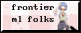

# FMLF Webring

## Add yourself

Submit a pull request adding your details to the `members` array in [`src/data/member.json`](src/data/member.json):

```json
{
  "id": "your-id",
  "name": "Your Name",
  "github": "your-github-username",
  "website": "https://your-website.example",
  "description": "A short introduction",
  "twitter": "https://x.com/your-username",
  "email": "you@example.com",
  "codeberg": "https://codeberg.org/your-username"
}
```

Use a unique, simple `id`; it is used in your webring links. `description`, `twitter`, `email`, and `codeberg` are optional. Open a PR with your change to request being added to the ring.

## Use the API

Add these links to your website, replacing `your-id` with the `id` you chose above:

```html
<a href="https://larpring.com/api/prev?from=your-id">Previous</a>
<a href="https://larpring.com/api/next?from=your-id">Next</a>
<a href="https://larpring.com/api/random?from=your-id">Random</a>
```

Each navigation endpoint redirects visitors to a member's website. The random endpoint excludes you when given your ID. The member list is available as JSON at <https://larpring.com/api/members>.

## Button



Frontier ML folks can use the button at [`assets/webring-button.gif`](assets/webring-button.gif) on their websites to link to the webring.
